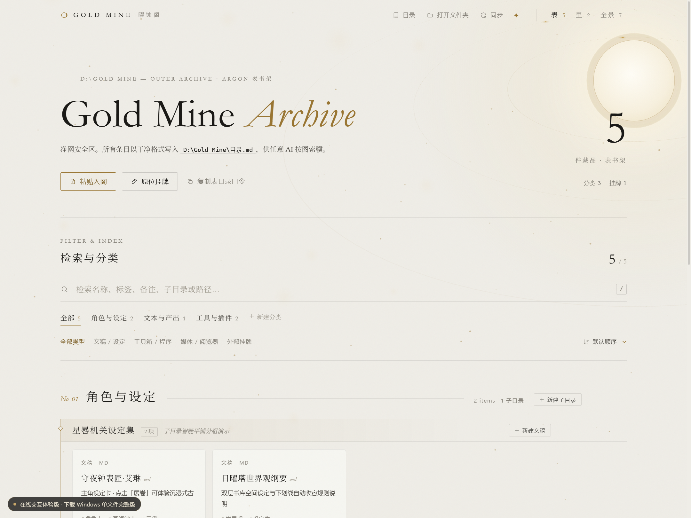
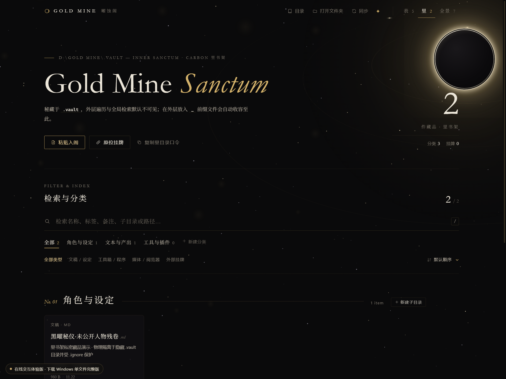

# Gold Mine · 曜蚀阁 (`v4.0`)

**人机双栖的纯本地知识库、角色设定集与工具军火库**  
一套目录，两面书架：正面为你提供古籍典藏级的沉浸式展卷阅读、媒体预览与工具一键启动；背面为桌面 AI 助手（Antigravity / Claude / Cursor 等）自动生成零正文污染、省 Token、防误扫私密草稿的精准导航书单。

<p>
  <a href="https://yuansamas3.github.io/gold-mine/" target="_blank"><b>👉 点此在电脑浏览器打开在线交互体验版 (Live Demo)</b></a>
  &nbsp;·&nbsp;
  <a href="https://github.com/Yuansamas3/gold-mine/releases" target="_blank"><b>📦 下载 Windows 绿色单文件开箱即用包 (Releases)</b></a>
</p>

---

## 界面实机预览

### 1. Eclipse 双牌门扉入口（星辉表书架 × 黑曜里圣所）
> 🎨 **门扉角色立绘致谢**：入口双牌立绘形象（`starlight.png` / `obsidian.png`）源自哔哩哔哩 UP 主 **[ZipZipPipe](https://space.bilibili.com/4168597)** 的 AI 拟人化系列创作，美术版权归原作者所有（右上角支持一键切换纯几何无立绘模式）。


### 2. ☀️ 表书架 · Outer Archive（象牙旧纸 · 净网公开索引区）


### 3. 🌙 里书架 · Inner Sanctum（墨黑古金 · `.vault` 隐秘隔离区）


---

## 为什么要做「曜蚀阁」？

平时攒下的大量 **角色设定卡、世界观草稿、Markdown 笔记、SillyTavern（酒馆）、解包与脚本工具** 散落在硬盘各处时，往往面临两个痛点：
1. **自己翻找麻烦**：多层文件夹来回翻找，看个 `.md` 还要开编辑器；大型工具包几十 GB 又不敢随便挪路径。
2. **让桌面 AI 找更灾难**：把大目录直接丢给桌面 AI，AI 动辄全盘 `grep / find` 盲扫，不仅瞬间烧掉海量上下文额度，一旦扫到未整理的私人草稿或敏感设定还会直接触发风控炸掉对话。

**曜蚀阁的解法：**
- **双空间物理隔离**：
  - **☀️ 表书架（`Gold Mine\<分类>\`）**：存放日常设定与通用工具，自动生成净网索引单 `目录.md`（**只记录分类、名称、路径与手写简短备注，绝不提取正文**）。点一下卡片上的「复制口令」发给 AI，AI 即可像按索书号借书一样秒读指定文件。
  - **🌙 里书架（`Gold Mine\.vault\<分类>\`）**：Windows 隐藏目录 + 根目录 `.ignore` 护盾，AI 全局搜索默认不可见；任何放入表目录但以英文下划线 `_` 开头的文件/文件夹（如 `_深夜草稿.md`），后台会自动剥离 `_` 前缀并静默收容进里书架。
- **零依赖纯本地单文件**：
  - 基于 Windows 10/11 原生自带 `.NET Framework` C# 编译为百余 KB 的绿色单文件 **`曜蚀阁.exe`**，无需安装 Python / Node.js 或任何运行库，双击驻留右下角托盘即开即用。
  - 仅绑定本机环回 `127.0.0.1`，**零联网、零遥测**，内置 `Host` 头防 DNS 重绑定校验、恒定时间会话令牌校验、符号链接/目录联接越界拦截（`GetFinalPathNameByHandleW`）与 60 秒即看即焚媒体预览票。
- **「原位挂牌」不搬家**：外部几十 GB 的大型软件或工程目录只需登记账本即可纳入书架管理与一键启动，摘牌或改分类绝不触碰外部原文件。
- **五代内置主题皮肤**：`.vault/ui/` 内完整保留 `v0` ~ `v4` 五代单文件界面皮肤，替换 `index.html` 刷新即换装。

---

## 快速上手（Windows）

1. 前往 [Releases](https://github.com/Yuansamas3/gold-mine/releases) 下载 `Gold_Mine_曜蚀阁_v4.0_纯净分享版.zip`（或直接 `git clone` 本仓库）解压到任意纯英文/中文路径；
2. 双击根目录下的 **`曜蚀阁.exe`**，浏览器将自动打开 `http://127.0.0.1:17890/`（右下角系统托盘常驻「阁」字图标，可随时打开目录、手动同步或退出）；
3. 详细功能、快捷键与皮肤切换说明请查阅仓库内的 [使用说明.md](./使用说明.md) 与设计文档 [DESIGN_NOTES.md](./.vault/ui/DESIGN_NOTES.md)。

### 从源码自行编译（零额外工具安装）
`曜蚀阁.exe` 完全由单文件源码 [.vault/src/GoldMine.cs](./.vault/src/GoldMine.cs) 使用系统自带编译器构建，可在 PowerShell 中一行重现编译：

```powershell
& "$env:WINDIR\Microsoft.NET\Framework64\v4.0.30319\csc.exe" /target:winexe /optimize+ /out:曜蚀阁.exe .vault\src\GoldMine.cs
```

---

## 致谢与版权声明 (Credits & License)

- **美术立绘署名**：门扉页所含角色立绘素材（`.vault/ui/assets/starlight.png` 与 `obsidian.png`）出自哔哩哔哩创作者 **[ZipZipPipe](https://space.bilibili.com/4168597)**，相关角色设计与插画版权归原作者所有，不在下方代码开源许可范围内，严禁将相关立绘素材用于任何商业用途；如有侵权或不妥之处请联系移除（界面右上角亦内置纯几何模式开关）。
- **源码开源协议**：本项目程序源码（[MIT](./LICENSE)）按原样免费开源供个人学习交流。
